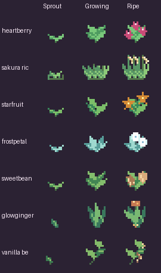
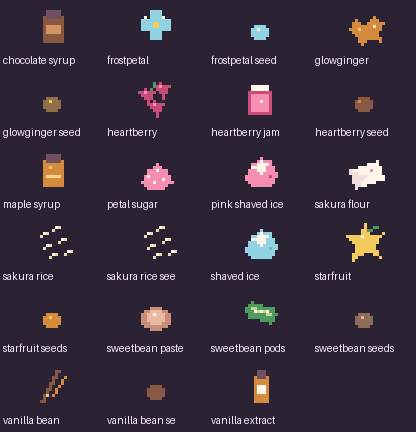
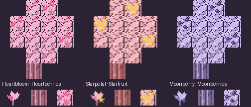

# Heartwater pantry pixel art

The pantry has three original 4-by-4 pixel-art atlases. The split scripts reduce each illustrated tile to a crisp 16-by-16 inventory icon with a small palette, hard-edged transparency and nearest-neighbor previews.

## First pantry atlas

| Row | Sprite names, left to right |
| --- | --- |
| 1 | sweet_berry_cheesecake_slice, apple_pie_slice, uwu_pancake_stack, pink_melon_popsicle |
| 2 | pink_fruit_salad, sweet_berry_cookie, blush_cabbage_roll, strawberry_milk |
| 3 | chorus_fruit_pie_slice, chorus_blossom_tea, dragon_breath_soda, shulker_soup |
| 4 | strider_moss_stew, nether_fungus_skewer, stuffed_hoglin_roast, magma_gelatin |

## Hearty-food atlas

| Row | Sprite names, left to right |
| --- | --- |
| 1 | blossom_ice_cream_bucket, strawberry_ice_cream_cake, flower_stuffed_chicken, heartberry_burger |
| 2 | blossom_hot_pocket, uwu_ramen_bowl, cherry_picnic_bento, berry_cinnamon_roll |
| 3 | starberry_waffle_stack, creamy_mushroom_stew, loaded_heart_potato, rose_berry_pie_slice |
| 4 | pastel_sakura_dumplings, honey_glazed_ham, moonberry_pudding, chicken_flower_pot_pie |

## Japanese and Canadian atlas

| Row | Sprite names, left to right |
| --- | --- |
| 1 | sakura_katsu_curry, heart_omurice, cherry_onigiri_bento, golden_taiyaki |
| 2 | cozy_udon_hotpot, sakura_melonpan, strawberry_shokupan, sweet_bean_dorayaki |
| 3 | sakura_mochi_ice_cream, maple_ice_cream_sundae, maple_poutine, tourtiere_hand_pie |
| 4 | nanaimo_heart_bar, maple_butter_tart, saskatoon_berry_pie_slice, maple_glazed_salmon_bowl |

The dishes take cues from Japanese regional cuisine and Canadian favorites such as poutine and tourtière, then give them an original pastel UwU Dimension presentation. The referenced cuisine mods are not required. Every pantry food has a shapeless recipe and may also appear in the dimension's Lootr chests.

## Dimension-grown pantry garden

Seven crops appear as small, varied patches in the UwU Dimension's Ribbon Bluffs, Lantern Fens, and Velvet Highlands. Their seeds only plant and grow in the dimension. Each has a distinct 16-by-16 pixel silhouette, transparent edges, and harvest details that appear as it matures: rice grains, heartberries, starfruit, frostpetal blooms, bean pods, ginger flowers, and vanilla pods. Mature crops drop their harvest and a seed so players can start a farm. Harvests include heartberries, sakura rice, starfruit, frostpetals, sweetbean pods, glowginger, and vanilla beans.

The harvests process into sakura rice flour, heartberry jam, sweetbean paste, petal sugar, and vanilla extract. Vanilla staples complete the pantry: snowballs make shaved ice, pink dye colors it pink, and cocoa beans with sugar and milk make chocolate syrup. Other recipes use honey bottles for maple syrup. These ingredients feed into the food recipes above without requiring Farmer's Delight or another food mod.

## Orchard trees

Heartbloom carries heartberries beneath pastel pink leaves, Starpetal bears starfruit, and Moonberry grows lavender fruit clusters. Their pixel-art saplings, custom logs and fruiting leaves appear in matching UwU Dimension surface biomes. Pick the visible fruit by interacting with a fruiting leaf block; fruit regrows over time.

